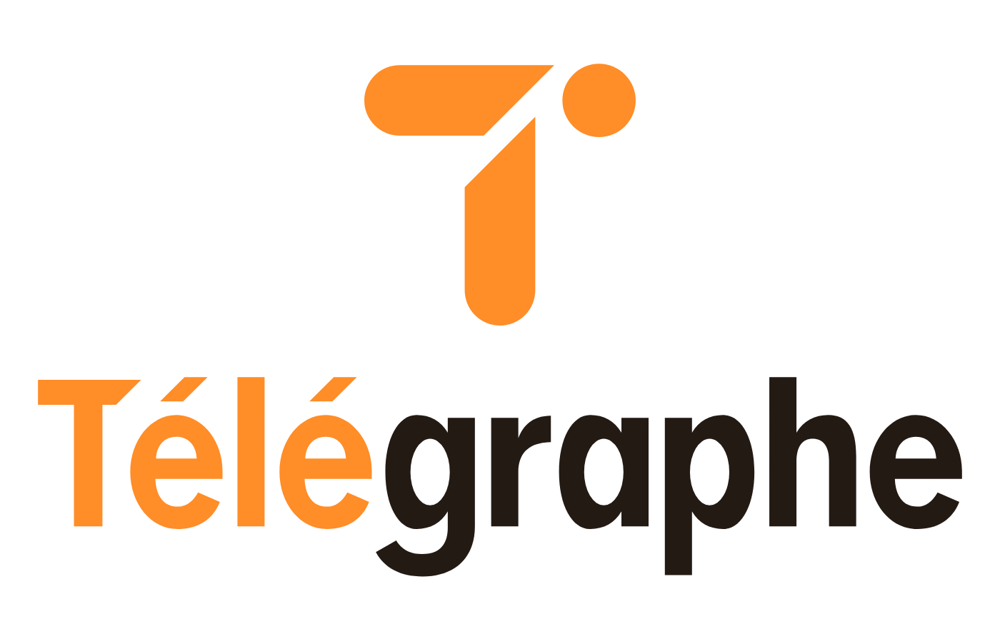

# Télégraphe Messenger

Télégraphe est une plateforme de messagerie instantanée multiplateforme (iOS & Android) conçue avec un objectif clair : offrir une communication rapide et sécurisée tout en protégeant les données personnelles de ses utilisateurs. Alliant les principes de souveraineté numérique à une expérience utilisateur unique, Télégraphe redéfinit les standards de la messagerie moderne.
